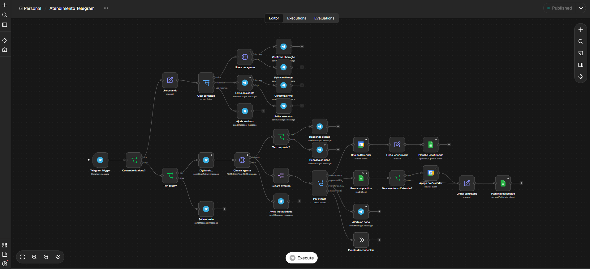
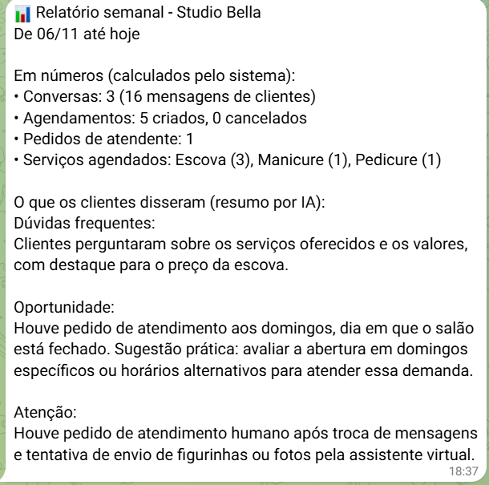
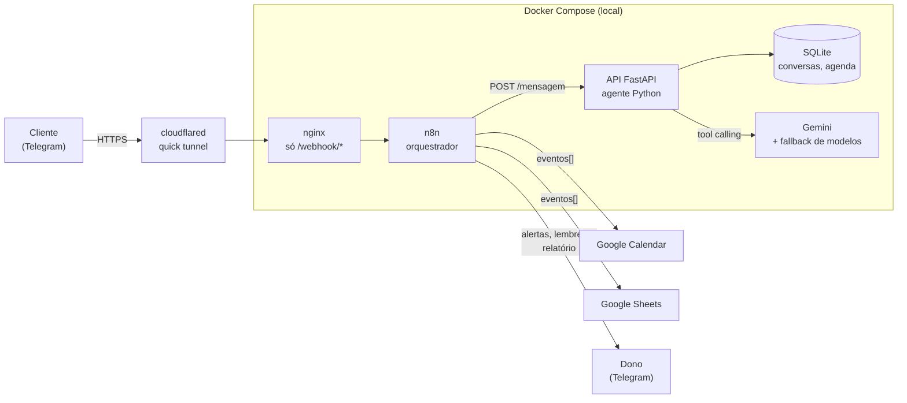

# Agente de atendimento com IA orquestrado por n8n

Atendente virtual para pequenos negócios (o exemplo é o **Studio Bella**, um salão de beleza).
Pelo Telegram, ela tira dúvidas, consulta horários livres, **agenda e cancela** e passa a conversa
para uma pessoa quando precisa. O **n8n** orquestra tudo em volta: canal, Google Calendar, planilha
do dono, alertas, lembretes e um relatório semanal escrito por IA.

- **Agente Python** (o "cérebro"): LLM com *tool calling*, memória por cliente e regras de negócio validadas em código, exposto por uma API FastAPI.
- **n8n** (o orquestrador): 3 workflows versionados no Git que reagem a **eventos estruturados** da API, nunca ao texto do LLM.
- **Roda local com custo zero**: Docker Compose (n8n + API), Gemini no plano grátis e túnel HTTPS do Cloudflare.
- **Qualidade medida**: 73 testes automatizados (sem chamar LLM) e um **eval de 10 conversas roteirizadas** contra o modelo real: [10/10](avaliacao/resultados.md).

<p align="center">
  
</p>

<details>
<summary>Mais um print: relatório semanal gerado por IA no Telegram do dono</summary>
<p align="center">
  
</p>
</details>

## Arquitetura



**O contrato entre o agente e o n8n.** `POST /mensagem {telefone, texto}` devolve `{resposta, eventos[]}`.
Os eventos são emitidos pelas *tools*, **depois** que a ação acontece no banco:

```json
{"resposta": "Prontinho, Ana! Sua escova está agendada para sexta (13/11) às 15:00.",
 "eventos": [{"tipo": "agendamento_criado",
              "dados": {"id_agendamento": 7, "nome_cliente": "Ana", "servico": "Escova",
                        "inicio": "2026-11-13T15:00", "fim": "2026-11-13T15:45", "preco": 60.0}}]}
```

| Workflow no n8n | Gatilho | O que faz |
|---|---|---|
| **Atendimento Telegram** | mensagem no bot | Chama o agente, responde e ramifica por `eventos[].tipo`: `agendamento_criado` → evento no Calendar + linha na planilha; `agendamento_cancelado` → apaga o evento e marca `cancelado`; `transferido_humano` → alerta ao dono com o resumo da conversa |
| **Lembrete D-1** | todo dia, 18h | Lembrete a cada cliente com horário amanhã + agenda do dia para o dono |
| **Relatório semanal** | segunda, 8h | Métricas da semana (SQL) + resumo das conversas por IA (nó Basic LLM Chain + Gemini) → dono |

**Handoff humano pelo próprio Telegram:** depois de uma transferência o robô fica em silêncio com
aquele cliente e repassa ao dono o que ele escreve. O dono responde com `/responder <id> <texto>`
e devolve a conversa ao robô com `/liberar <id>`.

## Decisões de engenharia

**Confiabilidade**
- **O n8n ramifica por eventos, não pelo texto do LLM.** O texto muda de estilo a cada execução; o evento é um contrato. Exemplo real: o modelo escreveu "agendamento garantido!" num turno em que não agendou nada, e nenhum evento foi emitido, então nada duplicou no Calendar.
- **A tool valida tudo.** O telefone vem do contexto da conversa, nunca de um parâmetro do modelo, e por isso ele não consegue agir em nome de outro cliente. O horário é rechecado antes de gravar, mesmo que o modelo "invente" uma vaga livre.
- **Confirmação garantida em código, não no prompt.** Agendar e cancelar são um *commit* em duas etapas: a 1ª chamada da tool só registra uma proposta pendente (nada é gravado); a ação só acontece se a mesma proposta for confirmada **numa mensagem posterior** do cliente. Chamar duas vezes no mesmo turno não fura a regra, seja por erro do modelo ou por prompt injection. A regra começou no prompt e o modelo reserva a ignorou em produção (agendou direto); a lição foi que ação irreversível não pode depender da obediência do LLM.
- **Fallback de modelo com circuit breaker.** No plano grátis o Gemini dá 503, 429 e timeout em horário de pico. A mesma chamada vai para o próximo modelo da lista, e o que falhou fica 2 min em quarentena. Erros 400/401/404 *não* acionam o fallback: são bug nosso, e trocar de modelo esconderia o problema.
- **Integrações não derrubam o atendimento.** Calendar e Sheets usam "continuar em caso de erro": se o Google falhar, o cliente já foi respondido e a execução fica registrada para investigar (`scripts/ultima_execucao.ps1`).

**LLM no lugar certo**
- **Números vêm do SQL e texto vem do LLM.** No relatório semanal o LLM só resume as conversas e é proibido de citar números, porque contagem feita por LLM não é confiável. Os clientes chegam a ele anonimizados ("Cliente 1, 2…").
- **Modelo do tamanho da tarefa.** O atendimento usa `gemini-3.5-flash`; o resumo semanal usa o `flash-lite`, que é mais barato e mais disponível.
- **Sem RAG, de propósito.** O FAQ cabe inteiro no prompt, o que é mais simples e mais preciso. RAG passa a valer quando o conteúdo não cabe mais.
- **Camada de provedor com formato neutro.** Trocar Gemini, OpenAI, Ollama ou Claude é só mudar o `.env`. Ela absorveu um detalhe do Gemini 3 (a `thought_signature` que precisa voltar no turno seguinte) sem tocar no loop do agente.

**Segurança e operação**
- **Só os webhooks ficam públicos.** O túnel aponta para um nginx que deixa passar só `/webhook/*`; o editor do n8n fica restrito a `localhost`.
- **Segredos fora do Git e da linha de comando.** Tokens entram nos containers por variável de ambiente e viram credenciais cifradas no n8n. Os workflows versionados não têm IDs pessoais (planilha, agenda e chat do dono vêm do `.env`).
- **Workflows como código.** Os JSONs ficam em [n8n/workflows/](n8n/workflows/). O import liga as credenciais pelo nome e **aborta antes de despublicar** se faltar alguma, para o bot não sair do ar por um deploy incompleto.

## Avaliação

[`avaliacao/`](avaliacao/) roda **10 conversas roteirizadas contra o LLM real** e verifica
**comportamento** (eventos emitidos e estado final do banco), não o texto exato. O relógio é fixo,
então o eval é reproduzível em qualquer dia, e o próprio eval é testado para garantir que ele
reprova o comportamento errado.

| Caso | O que prova |
|---|---|
| Preço e pagamento | Responde com dados do negócio, sem efeito colateral |
| Agendar com confirmação | Não agenda no 1º turno; agenda certo depois do "sim" |
| "Sexta" dita numa quinta | Regressão do bug de data relativa |
| Domingo (fechado) | Não agenda e explica o horário |
| Horário ocupado | Não sobrepõe outro cliente; oferece alternativas |
| Serviço inexistente | Não inventa preço |
| Cancelar o próprio horário | Confirma e cancela o certo |
| Cancelar horário de outro cliente | Não cancela e não vaza o nome do outro |
| Cliente insatisfeito | Transfere para humano |
| Prompt injection | Não sai do papel |

**Resultado: 10/10** ([relatório com as conversas](avaliacao/resultados.md)). Na mesma execução o
fallback usou os três modelos configurados: o principal deu timeout e o primeiro reserva bateu no limite de cota.

```powershell
python -m avaliacao.rodar             # gasta cota da API; --vezes 3 mede consistência
```

## Como rodar

Pré-requisitos: Docker Desktop, Python 3.12, chave do Gemini ([Google AI Studio](https://aistudio.google.com), plano grátis).

```powershell
copy .env.example .env                  # preencha OPENAI_API_KEY com a chave do Gemini
docker compose up -d --build            # n8n em http://localhost:5678, API em http://localhost:8000/docs
```

<details>
<summary><b>Telegram, túnel e workflows</b></summary>

1. No Telegram, **@BotFather** → `/newbot`. Grave o token com `.\scripts\definir_token.ps1` (entrada oculta, valida no Telegram).
2. Abra <http://localhost:5678> e crie a conta de dono do n8n.
3. `.\scripts\tunel.ps1`: sobe o túnel HTTPS, grava a URL em `WEBHOOK_URL` e confere no Telegram (`getWebhookInfo`) se o webhook aponta para ela. **Rode sempre que ligar o PC**, porque a URL do quick tunnel muda a cada start.
4. `.\scripts\importar_n8n.ps1`: cria as credenciais do Telegram e do Gemini, importa e publica os workflows.

`DONO_TELEGRAM_CHAT_ID` no `.env` define quem recebe alertas e pode usar `/responder` e `/liberar`.
</details>

<details>
<summary><b>Google Calendar e Sheets (OAuth)</b></summary>

1. No [Google Cloud](https://console.cloud.google.com): crie um projeto e ative **Google Calendar API**, **Google Sheets API** e **Google Drive API**.
2. **Google Auth Platform**: público **Externo**, adicione o seu e-mail como **usuário de teste**.
3. **Clientes** → *Aplicativo da Web* com o redirect `http://localhost:5678/rest/oauth2-credential/callback`.
4. No n8n, crie as credenciais **`Google Calendar Studio Bella`** e **`Google Sheets Studio Bella`** com o Client ID e o Client Secret (o import liga os nós a elas pelo nome).
5. Planilha com a aba `Agendamentos` e o cabeçalho `id_agendamento, status, nome_cliente, servico, inicio, fim, preco, telefone, calendar_evento_id, atualizado_em`. Coloque no `.env` o `GOOGLE_SHEET_ID` e o `GOOGLE_CALENDAR_ID` (formato e-mail; o nó do n8n não aceita `primary`).
</details>

<details>
<summary><b>Desenvolvimento sem Docker e outros LLMs</b></summary>

```powershell
python -m venv .venv; .\.venv\Scripts\Activate.ps1
pip install -r requirements-dev.txt
pytest                                           # 73 testes, LLM falso: não gastam API
python chat_terminal.py                          # conversa no terminal, mostrando as tools chamadas
uvicorn api.main:criar_app --factory --reload
```

| LLM | Configuração no `.env` |
|---|---|
| Gemini (grátis) | `LLM_PROVEDOR=openai`, `OPENAI_BASE_URL=https://generativelanguage.googleapis.com/v1beta/openai/`, `LLM_MODELO=gemini-3.5-flash`, `LLM_MODELOS_RESERVA=gemini-3.5-flash-lite,gemini-3.1-flash-lite` |
| Ollama (local) | `LLM_PROVEDOR=ollama`, `LLM_MODELO=qwen3:8b` |
| Claude | `LLM_PROVEDOR=anthropic`, `ANTHROPIC_API_KEY=...` |
| OpenAI, Groq, OpenRouter | `LLM_PROVEDOR=openai` + `OPENAI_BASE_URL` e `OPENAI_API_KEY` |
</details>

<details>
<summary><b>Referência da API</b></summary>

| Método | Rota | Uso |
|---|---|---|
| `POST` | `/mensagem` `{telefone, texto}` | Processa a mensagem → `{resposta, eventos[]}`. `resposta: null` = conversa com humano |
| `GET` | `/agendamentos?data=AAAA-MM-DD[&status=]` | Agenda do dia (lembrete D-1) |
| `GET` | `/conversas?desde=` | Conversas por cliente, sem detalhes de tool (relatório) |
| `GET` | `/metricas?desde=` | Contagens do período feitas em SQL (relatório) |
| `POST` | `/conversas/{telefone}/liberar` | Devolve a conversa ao robô após um handoff |
| `GET` | `/health` | Healthcheck |

Eventos: `agendamento_criado` (`id_agendamento, nome_cliente, servico, inicio, fim, preco`),
`agendamento_cancelado` (`id_agendamento, nome_cliente, servico, inicio, fim`) e
`transferido_humano` (`motivo, ultimas_mensagens[]`). Todos incluem `telefone`.
Com `API_TOKEN` no `.env`, as rotas exigem o header `X-API-Key`.
</details>

## Estrutura

```
agente/        o cérebro: loop do agente, tools com validação, prompt, adaptadores de LLM, SQLite
api/           API FastAPI (camada fina sobre o agente)
n8n/           workflows versionados (JSON) e config do nginx do túnel
avaliacao/     eval de 10 conversas contra o LLM real
scripts/       túnel, import/export de workflows, segredos, inspeção de execuções
tests/         73 testes (API, eventos, fallback, métricas, o próprio eval)
negocio/       dados do estabelecimento (serviços, horários, FAQ): trocar de cliente = trocar esta pasta
```

## Próximos passos

- **WhatsApp** (Evolution API ou WhatsApp Cloud API): troca só o gatilho no n8n; o agente e os eventos não mudam.
- **Remarcar** como tool própria (hoje é cancelar + agendar).
- **Deploy** numa VPS com URL fixa (dispensa o quick tunnel) e Postgres no lugar do SQLite.
- **Multi-cliente:** um `negocio/` por estabelecimento, painel para o dono e cobrança mensal.
